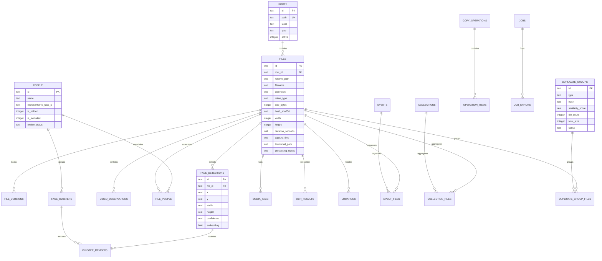

# Database Schema Documentation

## Product: Nexora — AI File Manager
**Tagline:** *"Your files. Your intelligence. Your control."*  
**Canonical Version:** `0.1.0`  
**Database Engine:** SQLite 3 (via `better-sqlite3` v11.6.0)  
**Schema Version:** 1 (`001_initial.sql`)  
**Storage Location:** `%APPDATA%\nexora\nexora.db`  

---

## 1. Engine Configuration & Pragmas

On database initialization, the connection is configured with performance and reliability pragmas:
- **`PRAGMA journal_mode = WAL;`**: Write-Ahead Logging allows concurrent reads while writes are in progress, significantly reducing read-lock latency.
- **`PRAGMA foreign_keys = ON;`**: Enforces relational integrity and cascading deletes across child tables.
- **`PRAGMA busy_timeout = 5000;`**: Sets a 5-second wait queue for lock acquisition to prevent `SQLITE_BUSY` errors during concurrent background indexing.

---

## 2. Entity Relationship Diagram (ERD)



---

## 3. Table Definitions

### 3.1 Migration Management
#### `schema_version`
Tracks applied database migration scripts.
| Column | Type | Constraints | Description |
| :--- | :--- | :--- | :--- |
| `version` | `INTEGER` | `PRIMARY KEY` | Migration integer version number |
| `applied_at` | `TEXT` | `NOT NULL DEFAULT (datetime('now'))` | ISO timestamp of application |
| `description` | `TEXT` | | Human-readable migration description |

---

### 3.2 Roots & Filesystem
#### `roots`
Registered directory roots (indexed, watched, managed).
| Column | Type | Constraints | Description |
| :--- | :--- | :--- | :--- |
| `id` | `TEXT` | `PRIMARY KEY` | UUID v4 identifier |
| `path` | `TEXT` | `NOT NULL UNIQUE` | Normalized Windows directory path |
| `label` | `TEXT` | `NOT NULL` | Display name for the directory root |
| `type` | `TEXT` | `CHECK(type IN ('indexed', 'watched', 'managed'))` | Root classification |
| `active` | `INTEGER` | `NOT NULL DEFAULT 1` | Boolean flag (0=disabled, 1=enabled) |
| `created_at` | `TEXT` | `NOT NULL DEFAULT (datetime('now'))` | Creation timestamp |
| `updated_at` | `TEXT` | `NOT NULL DEFAULT (datetime('now'))` | Last modification timestamp |

#### `files`
Master indexed catalog of all discovered files.
| Column | Type | Constraints | Description |
| :--- | :--- | :--- | :--- |
| `id` | `TEXT` | `PRIMARY KEY` | UUID v4 identifier |
| `root_id` | `TEXT` | `NOT NULL REFERENCES roots(id) ON DELETE CASCADE` | Parent directory root |
| `relative_path` | `TEXT` | `NOT NULL` | Relative path from root |
| `filename` | `TEXT` | `NOT NULL` | Base filename with extension |
| `extension` | `TEXT` | `NOT NULL DEFAULT ''` | Lowercase file extension (e.g. `.jpg`) |
| `mime_type` | `TEXT` | `NOT NULL DEFAULT 'application/octet-stream'` | Detected MIME content type |
| `size_bytes` | `INTEGER`| `NOT NULL DEFAULT 0` | File size on disk in bytes |
| `hash_sha256` | `TEXT` | | SHA-256 cryptographic checksum |
| `width` | `INTEGER`| | Image/video pixel width |
| `height` | `INTEGER`| | Image/video pixel height |
| `duration_seconds` | `REAL` | | Media clip duration in seconds |
| `capture_time` | `TEXT` | | EXIF `DateTimeOriginal` ISO string |
| `file_created_at`| `TEXT` | | Filesystem creation timestamp |
| `file_modified_at`| `TEXT`| | Filesystem modification timestamp |
| `has_gps` | `INTEGER`| `NOT NULL DEFAULT 0` | 1 if GPS metadata is present |
| `latitude` | `REAL` | | WGS84 decimal latitude |
| `longitude` | `REAL` | | WGS84 decimal longitude |
| `thumbnail_path` | `TEXT` | | Local path to downscaled thumbnail |
| `metadata_json` | `TEXT` | | Raw JSON blob of camera/exif attributes |
| `processing_status`| `TEXT` | `CHECK(processing_status IN ('pending', 'processing', 'completed', 'failed', 'skipped'))` | Current indexing state |
| `last_scanned_at`| `TEXT` | `NOT NULL DEFAULT (datetime('now'))` | Timestamp of last filesystem scan |
| `created_at` | `TEXT` | `NOT NULL DEFAULT (datetime('now'))` | Record creation timestamp |
| `updated_at` | `TEXT` | `NOT NULL DEFAULT (datetime('now'))` | Record update timestamp |
| **Constraint** | `UNIQUE(root_id, relative_path)` | | Prevents duplicate file paths per root |

#### `file_versions`
Audit log of detected file modifications, renames, and moves.
| Column | Type | Constraints | Description |
| :--- | :--- | :--- | :--- |
| `id` | `TEXT` | `PRIMARY KEY` | Version record UUID |
| `file_id` | `TEXT` | `NOT NULL REFERENCES files(id) ON DELETE CASCADE` | Associated file record |
| `hash_sha256` | `TEXT` | `NOT NULL` | File checksum at time of detection |
| `size_bytes` | `INTEGER`| `NOT NULL` | Size at time of detection |
| `detected_at` | `TEXT` | `NOT NULL DEFAULT (datetime('now'))` | Timestamp of detection |
| `change_type` | `TEXT` | `CHECK(change_type IN ('created', 'modified', 'renamed', 'moved', 'deleted'))` | Nature of change |

---

### 3.3 Facial Recognition & Clustering
#### `people`
Named and unreviewed human identities.
| Column | Type | Constraints | Description |
| :--- | :--- | :--- | :--- |
| `id` | `TEXT` | `PRIMARY KEY` | Person UUID |
| `name` | `TEXT` | | Human-assigned name (e.g. "Alice") |
| `representative_face_id` | `TEXT` | | ID of face detection used as avatar |
| `is_hidden` | `INTEGER`| `NOT NULL DEFAULT 0` | 1 to hide from main people view |
| `is_excluded` | `INTEGER`| `NOT NULL DEFAULT 0` | 1 to exclude from clustering |
| `review_status` | `TEXT` | `CHECK(review_status IN ('unreviewed', 'reviewed', 'confirmed'))` | Workflow status |
| `created_at` | `TEXT` | `NOT NULL DEFAULT (datetime('now'))` | Creation timestamp |
| `updated_at` | `TEXT` | `NOT NULL DEFAULT (datetime('now'))` | Last modification timestamp |

#### `face_detections`
Individual face occurrences detected within an image.
| Column | Type | Constraints | Description |
| :--- | :--- | :--- | :--- |
| `id` | `TEXT` | `PRIMARY KEY` | Detection UUID |
| `file_id` | `TEXT` | `NOT NULL REFERENCES files(id) ON DELETE CASCADE` | Source image |
| `x` | `REAL` | `NOT NULL` | Normalized bounding box X coordinate |
| `y` | `REAL` | `NOT NULL` | Normalized bounding box Y coordinate |
| `width` | `REAL` | `NOT NULL` | Normalized bounding box width |
| `height` | `REAL` | `NOT NULL` | Normalized bounding box height |
| `confidence` | `REAL` | `NOT NULL` | Neural model detection confidence |
| `quality_score` | `REAL` | | Sharpness/pose quality assessment |
| `embedding` | `BLOB` | | Binary vector embedding |
| `embedding_model` | `TEXT` | | Model identifier (e.g. `facenet512`) |
| `embedding_version`| `INTEGER`| | Numerical model version |
| `thumbnail_path` | `TEXT` | | Cropped face thumbnail path |
| `is_excluded` | `INTEGER`| `NOT NULL DEFAULT 0` | Flag to suppress detection |
| `created_at` | `TEXT` | `NOT NULL DEFAULT (datetime('now'))` | Timestamp |

#### `face_clusters`
Aggregated clusters of face detections sharing high cosine similarity.
| Column | Type | Constraints | Description |
| :--- | :--- | :--- | :--- |
| `id` | `TEXT` | `PRIMARY KEY` | Cluster UUID |
| `person_id` | `TEXT` | `REFERENCES people(id) ON DELETE SET NULL` | Associated person record |
| `centroid_embedding`| `BLOB` | | Mean vector centroid of cluster |
| `model_version` | `TEXT` | | Model version string |
| `member_count` | `INTEGER`| `NOT NULL DEFAULT 0` | Number of detections in cluster |
| `avg_confidence`| `REAL` | `NOT NULL DEFAULT 0` | Average confidence score |
| `created_at` | `TEXT` | `NOT NULL DEFAULT (datetime('now'))` | Creation timestamp |
| `updated_at` | `TEXT` | `NOT NULL DEFAULT (datetime('now'))` | Last update timestamp |

#### `cluster_members`
Association between clusters and specific face detections.
| Column | Type | Constraints | Description |
| :--- | :--- | :--- | :--- |
| `cluster_id` | `TEXT` | `NOT NULL REFERENCES face_clusters(id) ON DELETE CASCADE` | Cluster ID |
| `face_detection_id`| `TEXT` | `NOT NULL REFERENCES face_detections(id) ON DELETE CASCADE` | Face detection ID |
| `distance` | `REAL` | `NOT NULL` | Cosine distance to cluster centroid |
| `added_at` | `TEXT` | `NOT NULL DEFAULT (datetime('now'))` | Association timestamp |
| **Constraint** | `PRIMARY KEY (cluster_id, face_detection_id)` | | Composite primary key |

#### `file_people`
Many-to-many relationship linking files directly to confirmed people.
| Column | Type | Constraints | Description |
| :--- | :--- | :--- | :--- |
| `file_id` | `TEXT` | `NOT NULL REFERENCES files(id) ON DELETE CASCADE` | File ID |
| `person_id` | `TEXT` | `NOT NULL REFERENCES people(id) ON DELETE CASCADE` | Person ID |
| `association_type` | `TEXT` | `CHECK(association_type IN ('auto', 'manual', 'confirmed'))` | Association mechanism |
| `created_at` | `TEXT` | `NOT NULL DEFAULT (datetime('now'))` | Timestamp |
| **Constraint** | `PRIMARY KEY (file_id, person_id)` | | Composite primary key |

---

### 3.4 Media Metadata & Locations
- **`media_tags`**: User, AI, and OCR tags (`id`, `file_id`, `tag`, `source`, `confidence`).
- **`ocr_results`**: Optical character recognition text extracted from documents (`id`, `file_id`, `text`, `language`, `confidence`).
- **`locations`**: Normalized geographical points (`id`, `file_id`, `latitude`, `longitude`, `place_name`, `city`, `country`).
- **`events`** & **`event_files`**: Auto-generated and manual chronological event groupings.
- **`collections`** & **`collection_files`**: Static and smart query photo albums.

---

### 3.5 Deduplication
#### `duplicate_groups`
Identified duplicate file clusters.
| Column | Type | Constraints | Description |
| :--- | :--- | :--- | :--- |
| `id` | `TEXT` | `PRIMARY KEY` | Group UUID |
| `type` | `TEXT` | `CHECK(type IN ('exact', 'similar'))` | `exact` (SHA-256) or `similar` (dHash) |
| `hash` | `TEXT` | | Cryptographic or perceptual hash string |
| `similarity_score` | `REAL` | | Similarity coefficient for near-matches |
| `file_count` | `INTEGER`| `NOT NULL DEFAULT 0` | Number of files in duplicate set |
| `total_size` | `INTEGER`| `NOT NULL DEFAULT 0` | Cumulative byte size |
| `status` | `TEXT` | `CHECK(status IN ('pending', 'reviewed', 'resolved'))` | Resolution status |
| `created_at` | `TEXT` | `NOT NULL DEFAULT (datetime('now'))` | Creation timestamp |

#### `duplicate_group_files`
| Column | Type | Constraints | Description |
| :--- | :--- | :--- | :--- |
| `group_id` | `TEXT` | `NOT NULL REFERENCES duplicate_groups(id) ON DELETE CASCADE` | Duplicate group |
| `file_id` | `TEXT` | `NOT NULL REFERENCES files(id) ON DELETE CASCADE` | Associated file |
| `is_original`| `INTEGER`| `NOT NULL DEFAULT 0` | 1 if designated as master copy |
| **Constraint**| `PRIMARY KEY (group_id, file_id)` | | Composite primary key |

---

### 3.6 Background Processing & Operations
- **`jobs`**: Background worker queue records (`id`, `type`, `status`, `priority`, `progress`, `total`, `target_path`, `config_json`, `error_message`, `retry_count`, `max_retries`).
- **`job_errors`**: Detailed diagnostic log of worker failures with recoverability flags.
- **`watch_roots`**: Monitored Windows directories with `chokidar` flags (`path`, `auto_index`, `auto_organize`, `exclude_patterns`).
- **`copy_operations`** & **`operation_items`**: Non-destructive batch file copies with SHA-256 source/destination verification and rollback status.
- **`operation_history`**: Audit log of reversible organization transactions.
- **`app_settings`**: Key-value application configuration store (`key`, `value`, `type`, `category`).

---

### 3.7 Full-Text Search Virtual Table (`search_index`)
SQLite FTS5 virtual table tokenizing file contents for sub-millisecond keyword searches:
```sql
CREATE VIRTUAL TABLE IF NOT EXISTS search_index USING fts5(
  file_id UNINDEXED,
  filename,
  path,
  tags,
  ocr_text,
  metadata,
  content='',
  contentless_delete=1,
  tokenize='unicode61'
);
```

---

## 4. Indexing Strategy

Critical database indexes optimize high-volume queries:
- `idx_files_root` on `files(root_id)`
- `idx_files_hash` on `files(hash_sha256)` (for exact duplicate matching)
- `idx_files_capture_time` on `files(capture_time)` (for timeline rendering)
- `idx_files_size` on `files(size_bytes)` (for storage analytics)
- `idx_people_status` on `people(review_status)` (for review workflow)
- `idx_jobs_status` on `jobs(status)` (for queue processing)
- `idx_dup_groups_hash` on `duplicate_groups(hash)`
- `idx_locations_coords` on `locations(latitude, longitude)`
