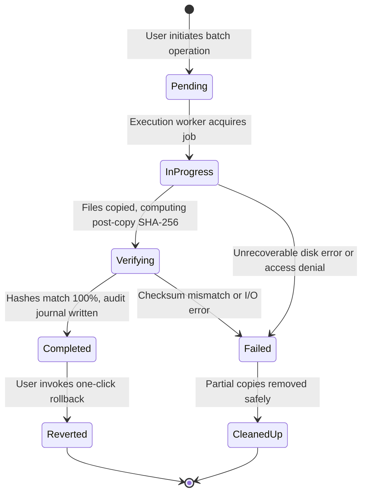

# File Operations & Safety Specifications

## Product: Nexora — AI File Manager
**Tagline:** *"Your files. Your intelligence. Your control."*  
**Platform:** Windows 11 Desktop  
**Canonical Version:** `0.1.0`

---

## 1. Core Safety Philosophy: Copy-First Preservation

Nexora is engineered on a non-negotiable safety invariant: **Original user files are immutable and must never be altered, moved, or deleted as an undocumented side effect of any automated operation.**

Traditional file organizers often perform in-place directory reorganizations or immediate destructive file moves. In contrast, Nexora enforces a strict **Copy-First Architecture**:

1. **Originals are Preserved**: Any intelligent organization, grouping, tag application, or folder restructuring generates new verified copies in the target destination while leaving the source directory completely intact.
2. **Explicit User Intent for Removal**: File removals, recycling, or hardlinking are strictly gated behind explicit, confirmed user interactions in dedicated management interfaces (such as the Duplicates resolver).
3. **Cryptographic Checksum Verification**: Every copied file undergoes mandatory pre-copy and post-copy SHA-256 hash validation before the operation is marked complete.
4. **Instant One-Click Reversibility**: All batch copy actions are recorded in an audit journal with atomic rollback capabilities.

---

## 2. Operation Lifecycle & State Machine

Every batch file operation follows a deterministic state machine tracked inside the local SQLite database.



### Operation States (`copy_operations.status`)

| Status | Description | Action Allowed |
| :--- | :--- | :--- |
| `pending` | Operation registered in database; awaiting execution queue slot. | Cancel |
| `in_progress` | Worker is actively streaming bytes from source to destination. | Pause, Abort |
| `verifying` | Byte transfer complete; worker calculating SHA-256 on target. | Monitor |
| `completed` | All items transferred and cryptographically verified. | One-Click Rollback |
| `failed` | One or more items failed verification or I/O error occurred. | Retry, Clean up partials |
| `reverted` | Rollback executed; destination files safely deleted. Source intact. | View audit history |

---

## 3. Database Audit Tracking

The schema tracks each operation and individual item in two relational tables defined in `database/migrations/001_initial.sql`:

### `copy_operations`
```sql
CREATE TABLE copy_operations (
    id TEXT PRIMARY KEY,
    source_root TEXT NOT NULL,
    destination_root TEXT NOT NULL,
    total_files INTEGER NOT NULL,
    total_bytes INTEGER NOT NULL,
    status TEXT NOT NULL DEFAULT 'pending',
    rollback_possible INTEGER NOT NULL DEFAULT 1,
    reverted_at TEXT,
    created_at TEXT NOT NULL DEFAULT (datetime('now')),
    completed_at TEXT
);
```

### `operation_items`
```sql
CREATE TABLE operation_items (
    id TEXT PRIMARY KEY,
    operation_id TEXT NOT NULL REFERENCES copy_operations(id) ON DELETE CASCADE,
    source_path TEXT NOT NULL,
    destination_path TEXT NOT NULL,
    file_size INTEGER NOT NULL,
    original_hash TEXT,
    copied_hash TEXT,
    verified INTEGER NOT NULL DEFAULT 0,
    status TEXT NOT NULL DEFAULT 'pending',
    error_message TEXT,
    created_at TEXT NOT NULL DEFAULT (datetime('now'))
);
```

---

## 4. Verification Protocol

To prevent silent data corruption, file truncation, or incomplete transfers across physical partitions or network mounts, Nexora implements a four-stage verification protocol:

```
[Source File]
     │
     ├── 1. Read source metadata (size, mtime, attributes)
     ├── 2. Calculate source SHA-256 hash (or retrieve cached hash)
     ├── 3. Stream bytes to temporary destination file (.nexora-tmp)
     ├── 4. Flush file buffers to physical disk storage
     ├── 5. Calculate destination SHA-256 hash
     ├── 6. Atomic compare: Source Hash == Destination Hash
     │       ├── MATCH: Atomic rename (.nexora-tmp -> destination)
     │       └── MISMATCH: Immediate deletion of temporary file, log error
     └── 7. Update operation_items (verified = 1, status = 'completed')
```

### Checksum Verification Rules
- If `original_hash` is already computed and stored in the `files` table, it is reused to eliminate redundant source disk reads.
- If the destination file exists prior to copying:
  - If identical hash: Item is flagged as `already_present` and skipped without overwrite.
  - If different hash: A collision suffix is appended (e.g., `IMG_0042 (1).JPG`) to guarantee no existing destination file is overwritten.

---

## 5. Rollback & Recovery Mechanism

Nexora features native rollback via the **History Page** (`HistoryPage.tsx`).

### Rollback Workflow
1. **User Invocation**: The user navigates to History and clicks **"Rollback Operation"** for a completed batch.
2. **Safety Verification**:
   - The engine queries all `operation_items` for the given `operation_id`.
   - For each `destination_path`, the engine validates that the file currently on disk matches `copied_hash`. If a user has since modified or replaced that destination file, the item is flagged and skipped to avoid destroying user changes.
3. **Safe Removal of Generated Copies**: Verified destination files are deleted or moved to the Windows Recycle Bin.
4. **Source Integrity Check**: Source files are confirmed to be intact.
5. **State Transition**: `copy_operations.status` is set to `'reverted'` and `reverted_at` is stamped with UTC ISO time.

---

## 6. Windows 11 Filesystem Edge Cases

Nexora handles native Windows filesystem quirks:

1. **Long Path Support (`MAX_PATH`)**:
   - Standard Windows APIs restrict paths to 260 characters. Nexora prefixes paths exceeding 240 characters with `\\?\` (e.g., `\\?\C:\Very\Long\Path\...`) to support deep folder hierarchies up to 32,767 characters.
2. **Locked Files & Sharing Violations (`EBUSY` / `EPERM`)**:
   - Files opened exclusively by other Windows processes (e.g., Office, media editors) trigger exponential backoff retry (3 attempts at 500ms, 1500ms, 4500ms).
   - If still locked, the item is logged as `locked_by_process` in `job_errors`, and the batch continues without halting.
3. **Case Sensitivity & NTFS Preservation**:
   - Windows NTFS preserves filename casing but performs case-insensitive comparisons. Nexora maintains the exact casing recorded from disk.
4. **Alternate Data Streams (ADS) & Attributes**:
   - Read-only, system, and hidden attributes are respected. Read-only flags are preserved on copied files.
