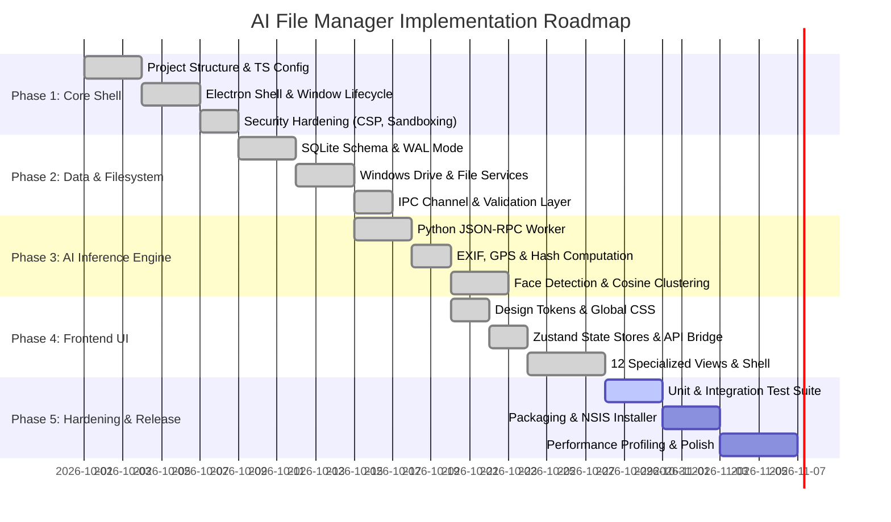

# Implementation Plan

## Project: AI File Manager for Windows 11
**Version:** 1.0.0  
**Status:** Executing / Phase 4 Complete  

---

## 1. Development Phases & Roadmap

---

## 2. Detailed Phase Breakdown

### Phase 1: Architectural Foundation & Desktop Shell (Complete)
- **Objective**: Establish the multi-process Electron foundation with strict context isolation and type safety.
- **Key Deliverables**:
  - Root `package.json` with scripts for dev, build, typecheck, and test.
  - Dual TypeScript compiler configs ([tsconfig.json](file:///e:/Code%20Tresure/File%20manager/tsconfig.json) and [tsconfig.main.json](file:///e:/Code%20Tresure/File%20manager/tsconfig.main.json)) targeting `Node16` / `ES2022`.
  - Electron main process entry ([src/main/index.ts](file:///e:/Code%20Tresure/File%20manager/src/main/index.ts)) with window controls, menu suppression, and security handlers (`will-navigate`, `setWindowOpenHandler`).
  - Preload bridge ([src/preload/index.ts](file:///e:/Code%20Tresure/File%20manager/src/preload/index.ts)) exposing `window.electronAPI`.
  - Strict Content Security Policy (`CSP`) in [src/renderer/index.html](file:///e:/Code%20Tresure/File%20manager/src/renderer/index.html).

### Phase 2: Local Database & Windows Filesystem Engine (Complete)
- **Objective**: Implement zero-dependency local storage and native Windows filesystem interaction.
- **Key Deliverables**:
  - High-performance SQLite database connection using `better-sqlite3` in Write-Ahead Logging (`WAL`) mode ([src/main/database.ts](file:///e:/Code%20Tresure/File%20manager/src/main/database.ts)).
  - Initial migration schema ([database/migrations/001_initial.sql](file:///e:/Code%20Tresure/File%20manager/database/migrations/001_initial.sql)) defining 25 core tables and FTS5 full-text search virtual table.
  - Standalone migration runner ([scripts/migrate.js](file:///e:/Code%20Tresure/File%20manager/scripts/migrate.js)).
  - Windows drive detection via `wmic logicaldisk` and directory reader ([src/main/filesystem.ts](file:///e:/Code%20Tresure/File%20manager/src/main/filesystem.ts)).
  - Type-safe IPC handlers with parameter validation ([src/main/ipc-handlers.ts](file:///e:/Code%20Tresure/File%20manager/src/main/ipc-handlers.ts)).

### Phase 3: Python AI Subprocess & Inference Pipeline (Complete)
- **Objective**: Build an isolated, resilient local AI inference engine for heavy image analysis.
- **Key Deliverables**:
  - Python worker script ([ai-worker/src/main.py](file:///e:/Code%20Tresure/File%20manager/ai-worker/src/main.py)) communicating over unbuffered stdin/stdout JSON-RPC.
  - Fast SHA-256 and MD5 hashing, plus 8x8 difference perceptual hashing (`dHash`).
  - EXIF header parsing, camera model identification, and GPS coordinate extraction.
  - Face detection bounding box normalization and pairwise cosine distance clustering.
  - Automated downscaled JPEG thumbnail generation.
  - Pure-Python fallbacks ensuring zero crashes on bare-bones Python environments.

### Phase 4: React 18 UI Shell & Specialized Views (Complete)
- **Objective**: Implement a modern, responsive Windows 11 Fluent dark-mode user interface.
- **Key Deliverables**:
  - Design system tokens ([tokens.css](file:///e:/Code%20Tresure/File%20manager/src/renderer/styles/tokens.css)) and global styling rules ([global.css](file:///e:/Code%20Tresure/File%20manager/src/renderer/styles/global.css)).
  - Scoped Zustand state stores ([store/index.ts](file:///e:/Code%20Tresure/File%20manager/src/renderer/store/index.ts)) and renderer API service ([services/api.ts](file:///e:/Code%20Tresure/File%20manager/src/renderer/services/api.ts)).
  - Main application shell ([App.tsx](file:///e:/Code%20Tresure/File%20manager/src/renderer/App.tsx)) with header, search shortcut, and Index Folder modal.
  - **12 Fully Functional Views**:
    1. Dashboard ([DashboardPage.tsx](file:///e:/Code%20Tresure/File%20manager/src/renderer/pages/DashboardPage.tsx))
    2. File Explorer ([ExplorerPage.tsx](file:///e:/Code%20Tresure/File%20manager/src/renderer/pages/ExplorerPage.tsx))
    3. People & Face Groups ([PeoplePage.tsx](file:///e:/Code%20Tresure/File%20manager/src/renderer/pages/PeoplePage.tsx))
    4. Smart Search ([SearchPage.tsx](file:///e:/Code%20Tresure/File%20manager/src/renderer/pages/SearchPage.tsx))
    5. Media Timeline ([TimelinePage.tsx](file:///e:/Code%20Tresure/File%20manager/src/renderer/pages/TimelinePage.tsx))
    6. Events & Places ([EventsPage.tsx](file:///e:/Code%20Tresure/File%20manager/src/renderer/pages/EventsPage.tsx))
    7. Duplicates Finder ([DuplicatesPage.tsx](file:///e:/Code%20Tresure/File%20manager/src/renderer/pages/DuplicatesPage.tsx))
    8. Storage Analytics ([StoragePage.tsx](file:///e:/Code%20Tresure/File%20manager/src/renderer/pages/StoragePage.tsx))
    9. Background Activity ([ActivityPage.tsx](file:///e:/Code%20Tresure/File%20manager/src/renderer/pages/ActivityPage.tsx))
    10. Reorganization History ([HistoryPage.tsx](file:///e:/Code%20Tresure/File%20manager/src/renderer/pages/HistoryPage.tsx))
    11. Watched Folders ([WatchedFoldersPage.tsx](file:///e:/Code%20Tresure/File%20manager/src/renderer/pages/WatchedFoldersPage.tsx))
    12. System Settings ([SettingsPage.tsx](file:///e:/Code%20Tresure/File%20manager/src/renderer/pages/SettingsPage.tsx))

### Phase 5: Verification, Quality Assurance & Packaging (Active)
- **Objective**: Verify test coverage, run performance benchmarks, and produce production release installers.
- **Key Deliverables**:
  - Vitest test suite ([vitest.config.ts](file:///e:/Code%20Tresure/File%20manager/vitest.config.ts), [filesystem.test.ts](file:///e:/Code%20Tresure/File%20manager/tests/unit/filesystem.test.ts), [types.test.ts](file:///e:/Code%20Tresure/File%20manager/tests/unit/types.test.ts)).
  - Production build pipeline (`npm run build`).
  - Standalone Windows NSIS installer package (`npm run package`).

---

## 3. Technical Dependencies & Constraints

| Dependency | Purpose | Target Version |
| :--- | :--- | :--- |
| `electron` | Desktop container and window host | `^33.2.1` |
| `react` / `react-dom` | UI component tree | `^18.3.1` |
| `vite` | Renderer bundler and dev server | `^6.0.3` |
| `better-sqlite3` | High-speed embedded database | `^11.6.0` |
| `zustand` | Lightweight reactive state management | `^5.0.2` |
| `chokidar` | Cross-platform filesystem watcher | `^4.0.3` |
| `sharp` | High-speed Node image processing | `^0.33.5` |
| `vitest` | Unit and integration test runner | `^2.1.8` |
| `electron-builder` | Windows NSIS installer packager | `^25.1.8` |

---

## 4. Risk Analysis & Mitigation Matrix

| Risk | Impact | Probability | Mitigation Strategy |
| :--- | :---: | :---: | :--- |
| **Native C++ Module Incompatibility** (`better-sqlite3` fails to load in new Node or Electron runtimes) | High | Medium | Execute `npx electron-builder install-app-deps` targeting the specific Electron ABI version. Pre-packaged releases bundle prebuilt binaries. |
| **Python Environment Gaps** (Target machine lacks Python or heavy ML packages) | Medium | Medium | Include standard library pure-Python fallback inside [ai-worker/src/main.py](file:///e:/Code%20Tresure/File%20manager/ai-worker/src/main.py). If Python is absent, Node-based mock metadata is provided. |
| **Database File Lock Contention** (Concurrent writes during bulk scans) | High | Low | Enforce SQLite Write-Ahead Logging (`PRAGMA journal_mode = WAL`) and configure `busy_timeout = 5000` to queue writes safely. |
| **Large Folder Rendering Lag** (Folders containing 50,000+ files) | Medium | Medium | Implement windowed virtual scrolling or pagination in Explorer and limit thumbnail load batches. |
| **Windows Max Path Limitation** (`MAX_PATH` 260 characters) | Medium | Low | Use standard Windows extended-length prefix (`\\?\`) where appropriate and normalize paths. |
