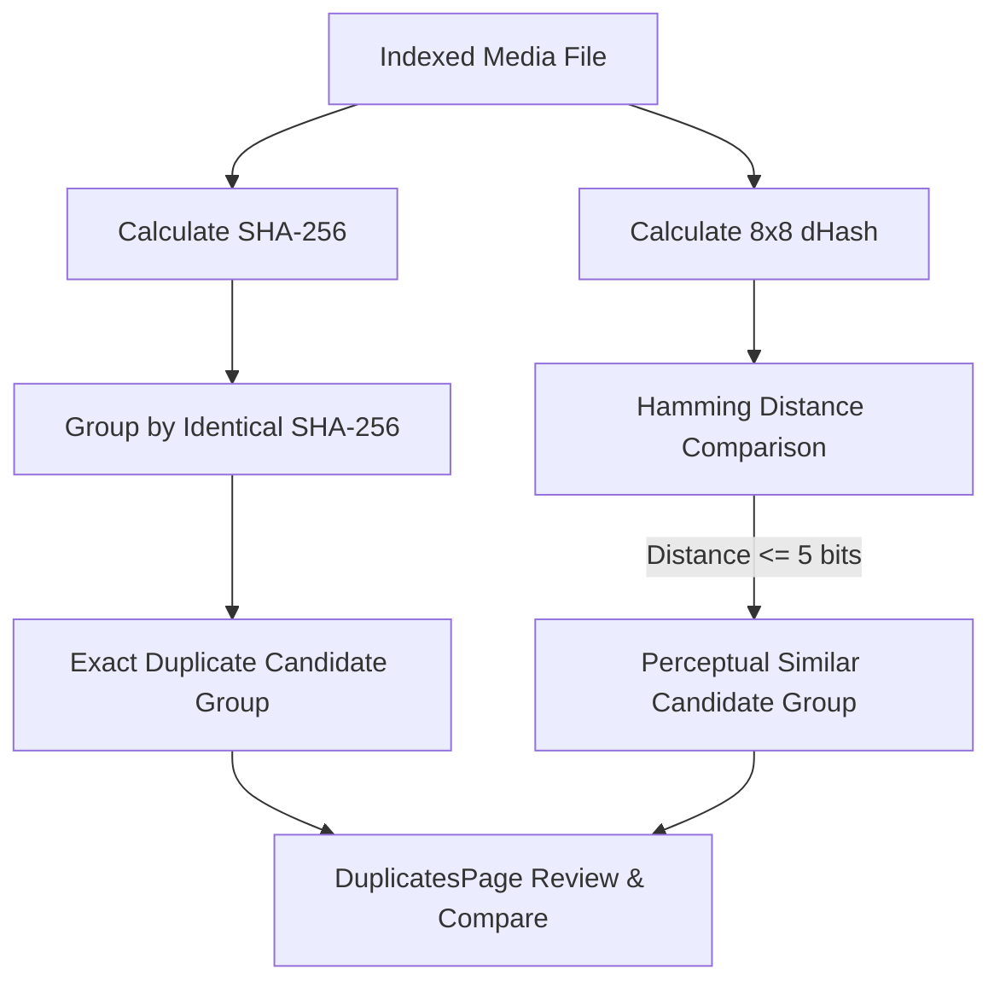

# Search Indexing & Duplicate Detection Specifications

## Product: Nexora — AI File Manager
**Tagline:** *"Your files. Your intelligence. Your control."*  
**Platform:** Windows 11 Desktop  
**Canonical Version:** `0.1.0`

---

## 1. Smart Search Architecture

Nexora combines high-speed SQLite B-tree index queries with full-text search (FTS5) to provide instant file discovery across hundreds of thousands of indexed files.

```
+--------------------------------------------------------------------------+
|                         Search Query Dispatcher                          |
+------------------------------------+-------------------------------------+
                                     |
              +----------------------+----------------------+
              |                                             |
              v                                             v
     +-----------------+                           +-----------------+
     | Structured      |                           | Full-Text FTS5  |
     | Parameters      |                           | Free-form Text  |
     +--------+--------+                           +--------+--------+
              |                                             |
              | * Extension (.jpg, .mp4)                    | * Filename
              | * Size range (min/max)                      | * OCR text
              | * Date range (capture/mtime)                | * AI descriptions
              | * Person ID (file_people)                   |
              | * Media tag (media_tags)                    |
              |                                             |
              +----------------------+----------------------+
                                     |
                                     v
                  +-------------------------------------+
                  |   Ranked Result Set & Latency Log   |
                  |     (Rendered in SearchPage.tsx)    |
                  +-------------------------------------+
```

### 1.1. Full-Text Search Virtual Table (`files_fts`)

Full-text queries leverage SQLite's native FTS5 extension defined in `database/migrations/001_initial.sql`:

```sql
CREATE VIRTUAL TABLE IF NOT EXISTS files_fts USING fts5(
    file_id UNINDEXED,
    filename,
    extension,
    ocr_text,
    ai_description,
    tokenize = 'porter unicode61'
);
```

- **Tokenization**: Uses `porter unicode61`, enabling word stemming (e.g., searching for "running" matches "run") and full Unicode support for multi-language filenames.
- **Triggers**: Synchronization between the `files` table and `files_fts` occurs automatically via database triggers on `INSERT`, `UPDATE`, and `DELETE`.

### 1.2. Multi-Parameter Search Filtering

Structured queries in `src/main/database.ts` construct efficient parameterized SQL filters:

```typescript
export interface SearchQuery {
  query?: string;
  extension?: string;
  minSize?: number;
  maxSize?: number;
  startDate?: string;
  endDate?: string;
  personId?: string;
  tag?: string;
  limit?: number;
  offset?: number;
}
```

- **Query Latency Monitoring**: Every search execution calculates millisecond elapsed time (`duration_ms = performance.now() - startTime`), displayed in the header of `SearchPage.tsx` to provide instant performance feedback.

---

## 2. Duplicate Detection Engine

Nexora identifies two distinct categories of duplicate files: **Exact Duplicates** and **Perceptual Duplicates**.



### 2.1. Exact Duplicate Detection (SHA-256)
- **Mechanism**: Grouping query on `files.sha256` where count exceeds 1.
- **Fidelity**: 100% bit-for-bit identity guarantee.
- **Scope**: Supports any file type (images, videos, documents, executables, archives).
- **Relational Storage**:
  - `duplicate_groups`: Records cluster ID, detection algorithm (`exact`), total count, and total reclaimable space.
  - `duplicate_group_files`: Links each file instance, marking the primary original (`is_original = 1`).

### 2.2. Perceptual Image Duplicate Detection (`dHash`)
- **Mechanism**: Compares 64-bit difference hashes (`files.phash`) using bitwise Hamming distance:
  $$\text{Hamming Distance} = \text{popcount}(\text{phash}_1 \oplus \text{phash}_2)$$
- **Threshold**:
  - `Distance == 0`: Identical image, potentially re-encoded or stripped of EXIF metadata.
  - `1 <= Distance <= 5`: Visually identical photo (e.g., slightly different compression quality, resized resolution, or camera burst mode frame).
- **Scope**: Image files (`.jpg`, `.jpeg`, `.png`, `.webp`, `.heic`).

---

## 3. Duplicate Handling & Resolution Actions

When viewing candidate groups in the **Duplicates View** (`DuplicatesPage.tsx`), users are presented with three non-destructive resolution strategies:

### 3.1. Strategy 1: "Keep Best" (Recommended)
1. Analyzes candidates in the duplicate group:
   - For images: Selects candidate with highest resolution (`width * height`), followed by most complete EXIF capture metadata.
   - For general files: Selects candidate with earliest creation timestamp.
2. Designates the superior file as the canonical original (`is_original = 1`).
3. Highlights remaining candidates for safe archiving or recycling.

### 3.2. Strategy 2: "Move to Recycle Bin" (Safe Recycling)
1. Candidate files are routed to the Windows Recycle Bin using Electron's native `shell.trashItem(filePath)`.
2. **Safety Guarantees**:
   - Files are never permanently unlinked or deleted directly by default.
   - Files can be restored by the user at any time from the Windows desktop Recycle Bin.
   - The primary original is protected and cannot be selected for recycling.

### 3.3. Strategy 3: "Hardlink Duplicates" (NTFS Space Reclaim)
1. On NTFS filesystems, duplicate file instances within the same partition can be converted to NTFS Hardlinks via Windows `CreateHardLinkW` API.
2. **Benefits**:
   - All file directory paths remain completely intact and accessible to other software.
   - Physical disk sectors are shared, immediately freeing duplicate storage space without moving files.

---

## 4. Safety Constraints & Invariants

1. **Path Collision Guard**: Before executing any deduplication action, the engine verifies that source and destination paths do not resolve to the exact same file on disk (guards against symbolic link circularity).
2. **Pre-Action Modal Confirmation**: All batch duplicate actions require explicit modal confirmation detailing:
   - Number of duplicate files to be recycled.
   - Exact volume of disk space to be recovered.
   - Path of the primary original file being preserved.
3. **Audit Trail**: Every resolution is recorded in `copy_operations` or activity log for auditing.
