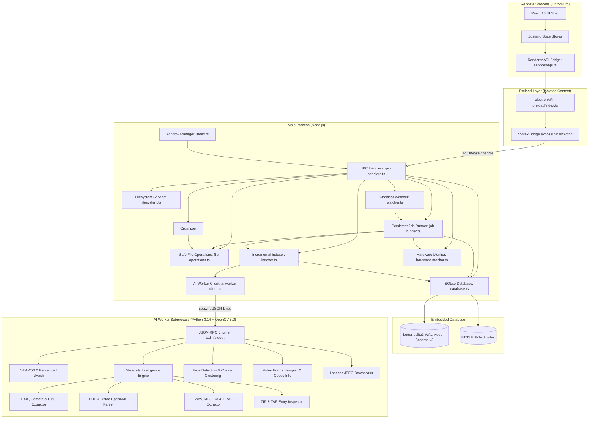
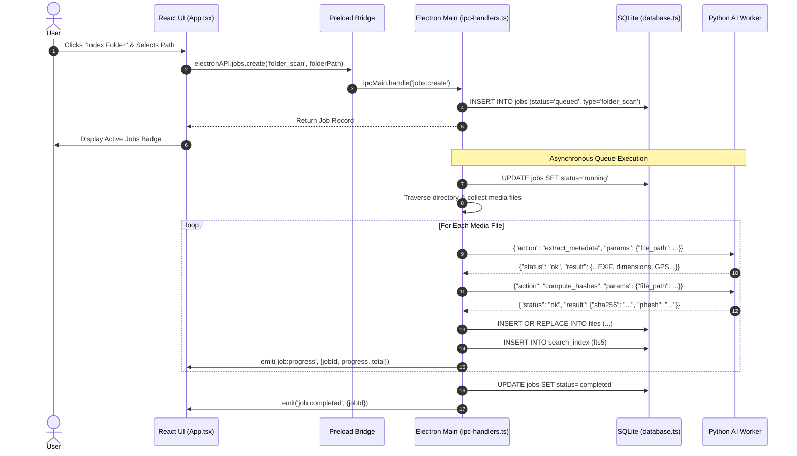

# System Architecture Documentation

## Product: Nexora — AI File Manager
**Tagline:** *"Your files. Your intelligence. Your control."*  
**Version:** 0.9.0  
**Status:** Implemented (v0.9.0 Security, Reliability & Performance Hardening Release)  
**Platform:** Windows 11 (x64) desktop  
**Visual Identity:** Cinematic, futuristic, minimal black/charcoal surfaces (`#0a0a0a`), neon-lime accents (`#b4ff32`), glassmorphism  

---

## 1. High-Level System Architecture

**Nexora** adopts a decoupled, multi-process desktop architecture designed for maximum security, local data privacy, and non-blocking asynchronous processing:

---

## 2. Process Model & Separation of Concerns

### 2.1 The Renderer Process (`src/renderer/`)
- **Technology**: React 18, Vite 6, TypeScript 5.7+, Vanilla CSS.
- **Responsibilities**:
  - Render all 12 views ([DashboardPage](file:///e:/Code%20Tresure/File%20manager/src/renderer/pages/DashboardPage.tsx), [ExplorerPage](file:///e:/Code%20Tresure/File%20manager/src/renderer/pages/ExplorerPage.tsx), [PeoplePage](file:///e:/Code%20Tresure/File%20manager/src/renderer/pages/PeoplePage.tsx), [SearchPage](file:///e:/Code%20Tresure/File%20manager/src/renderer/pages/SearchPage.tsx), [TimelinePage](file:///e:/Code%20Tresure/File%20manager/src/renderer/pages/TimelinePage.tsx), [EventsPage](file:///e:/Code%20Tresure/File%20manager/src/renderer/pages/EventsPage.tsx), [DuplicatesPage](file:///e:/Code%20Tresure/File%20manager/src/renderer/pages/DuplicatesPage.tsx), [StoragePage](file:///e:/Code%20Tresure/File%20manager/src/renderer/pages/StoragePage.tsx), [ActivityPage](file:///e:/Code%20Tresure/File%20manager/src/renderer/pages/ActivityPage.tsx), [HistoryPage](file:///e:/Code%20Tresure/File%20manager/src/renderer/pages/HistoryPage.tsx), [WatchedFoldersPage](file:///e:/Code%20Tresure/File%20manager/src/renderer/pages/WatchedFoldersPage.tsx), [SettingsPage](file:///e:/Code%20Tresure/File%20manager/src/renderer/pages/SettingsPage.tsx)).
  - Manage state via scoped Zustand stores (`useNavigationStore`, `useExplorerStore`, `useDashboardStore`, `useJobsStore`, `usePeopleStore`, `useWatcherStore`).
  - Render modal overlays, progress bars, and reactive toast notifications.
- **Security Constraint**: Zero access to Node.js `require`, `fs`, `child_process`, or direct OS APIs.

### 2.2 The Preload Bridge (`src/preload/`)
- **Technology**: Electron `contextBridge`, `ipcRenderer`.
- **Responsibilities**:
  - Expose a strictly typed `window.electronAPI` interface to the renderer.
  - Mediate request/response cycles and filter incoming event channels (`job:progress`, `job:completed`, `job:error`, `watcher:change`).
- **Security Constraint**: Runs in an isolated execution context (`contextIsolation: true`). Does not leak Electron internal references.

### 2.3 The Main Process (`src/main/`)
- **Technology**: Node.js, Electron, `better-sqlite3`, `chokidar`.
- **Responsibilities**:
  - App lifecycle, window creation, menu management, and security lockdowns (`will-navigate`, `setWindowOpenHandler`).
  - Handle all IPC commands, validating and sanitizing paths, IDs, and payload parameters.
  - Execute native Windows drive queries via `wmic logicaldisk` and filesystem traversals.
  - Maintain the SQLite database in Write-Ahead Logging (`WAL`) mode with versioned migrations.
  - Supervise background task queues and dispatch jobs.

### 2.4 The Python AI Worker (`ai-worker/`)
- **Technology**: Python 3.10+, Standard Library, Pillow, NumPy, SciPy (optional).
- **Responsibilities**:
  - Long-running computational inference: SHA-256 and perceptual difference hashing (`dHash`).
  - EXIF header parsing, GPS latitude/longitude extraction, camera model detection.
  - Face detection bounding box normalization, feature embedding, and pairwise cosine distance clustering.
  - Thumbnail resizing and JPEG compression.
- **Protocol**: Standard I/O (stdin/stdout) line-delimited JSON-RPC messages.

---

## 3. Core Sequence Flows

### 3.1 Folder Indexing & Background Processing Flow

---

## 4. State Management Architecture

State is managed via modular [Zustand](https://github.com/pmndrs/zustand) stores located in `src/renderer/store/index.ts`:

| Store | State Variables | Primary Actions |
| :--- | :--- | :--- |
| `useNavigationStore` | `currentPage`, `sidebarCollapsed` | `setPage(page)`, `toggleSidebar()` |
| `useExplorerStore` | `currentPath`, `entries`, `drives`, `selectedFiles`, `viewMode`, `sortBy`, `sortOrder`, `history` | `navigateTo(path)`, `loadDrives()`, `toggleSelection()`, `goBack()`, `goForward()`, `goUp()` |
| `useDashboardStore` | `stats`, `loading`, `error` | `fetchStats()` |
| `usePeopleStore` | `people`, `loading`, `selectedPersonId` | `fetchPeople()`, `selectPerson()`, `updatePerson()`, `deletePerson()` |
| `useJobsStore` | `jobs`, `loading` | `fetchJobs()`, `cancelJob()`, `pauseJob()`, `resumeJob()` |
| `useWatcherStore` | `watchRoots`, `loading` | `fetchWatchRoots()`, `addWatchRoot()`, `removeWatchRoot()`, `toggleWatchRoot()` |

---

## 5. Security & Isolation Controls

1. **Context Isolation**: `webPreferences.contextIsolation = true` ensures the renderer cannot modify or tamper with preload prototypes.
2. **Node Integration Disabled**: `webPreferences.nodeIntegration = false` prevents the execution of arbitrary Node.js scripts in the Chromium DOM.
3. **No External Script Ingestion**: Content Security Policy (`CSP`) defined in `src/renderer/index.html` restricts scripts to `'self'` and blocks remote executable code.
4. **Navigation Interception**:
   - `contents.setWindowOpenHandler(() => ({ action: 'deny' }))` denies unauthorized popup windows.
   - `contents.on('will-navigate', ...)` blocks top-level navigation to external web destinations.
5. **Path Traversal & Injection Defense**:
   - `validatePath()` normalizes incoming Windows paths and rejects null bytes (`\0`).
   - `validateId()` verifies UUID or alphanumeric formats to prevent SQL injection in dynamic statements.

---

## 6. Architecture Decision Records (ADRs)

### ADR-01: SQLite (`better-sqlite3`) as the Primary Data Store
- **Context**: The app must index hundreds of thousands of files with complex relationships (faces, clusters, GPS, tags) without cloud dependencies.
- **Decision**: Adopt SQLite via the synchronous, high-throughput `better-sqlite3` driver with Write-Ahead Logging (`WAL`).
- **Consequences**: Instant query execution, zero external daemon processes, full ACID compliance, and built-in FTS5 full-text search. Requires Electron native module compilation during install.

### ADR-02: Decoupled Python Subprocess for AI Inference
- **Context**: Face detection, clustering, and perceptual image hashing require numerical algorithms often best supported in Python.
- **Decision**: Isolate AI inference into a dedicated Python worker running over standard I/O (JSON-RPC) rather than binding heavyweight C++ libraries into the Electron main process.
- **Consequences**: If the AI model crashes on a corrupt image, the main application remains stable. Includes pure-Python fallbacks to run on minimal Python installations.

### ADR-03: Copy-First Non-Destructive File Organization
- **Context**: Automated photo organization tools risk accidental data loss if move or overwrite operations fail.
- **Decision**: All organization workflows use copy-first operations with mandatory SHA-256 source/destination hash verifications and maintain a reversible transaction history in `operation_history`.
- **Consequences**: User data is protected against corruption, partial transfers, or disk disconnections.

### ADR-04: Mandatory Invariants for Filename Handling, Duplicate Verification & Person Identity
- **Context**: Relying on filenames for duplicate detection or person attribution leads to false associations, while unmonitored concurrent file writes during hashing/copying can lead to corrupt copies or stale records.
- **Decision**: 
  1. Every file is an autonomous entity keyed by its canonical filesystem path and distinct `files.id`.
  2. Identical filenames across different paths are never duplicates or associated with the same person without identical SHA-256 hash or verified face matches.
  3. Exact duplicate detection requires byte-for-byte SHA-256 cryptographic verification; duplicates are registered in `duplicate_groups` with `status = 'pending'` and are never automatically deleted or overwritten.
  4. Person identities are strictly prohibited from being inferred from filenames. Person folders require confirmed/reviewed review status (`review_status IN ('confirmed', 'reviewed')`); unreviewed matches safely fallback to `Unassigned`. Multiple confirmed people in a single file are aggregated (e.g. `Alice & Bob`).
  5. In-flight file modifications during hashing (`computeFileSha256`) and copying (`copyFileWithVerification`) are detected via pre/post stream `stat` comparisons, aborting the operation, removing staging files, and invalidating affected results without corrupting targets.
- **Consequences**: Eliminates false-positive deduplication, prevents erroneous biometric tagging from filenames, ensures multi-person safety, and guarantees 100% original file preservation.

### ADR-05: Non-Negotiable Principle — Adaptive Performance Without Feature Loss
- **Context**: Desktop applications often resort to arbitrarily disabling features, silently dropping AI accuracy, downscaling neural inputs, or skipping files to run on low-end hardware. This creates fragmented tiers, inconsistent duplicate detection, and incomplete library processing.
- **Decision**: 
  1. **Adapt scheduling, not capabilities**: Feature sets remain identical across all hardware profiles (`low`, `balanced`, `performance`). Heavy AI operations are never disabled (`allowBackgroundAi = true` on all profiles).
  2. **Preserve accuracy invariants**: Model input resolution is standardized to 1600px across all profiles, preserving identical vector embeddings, matching thresholds ($\ge 0.70$), and clustering boundaries ($0.60$).
  3. **Resumable deferred AI pipeline**: On low-end systems or during dynamic resource throttling (>82% RAM or >85% CPU load), heavy AI operations are deferred to persistent Priority 4 jobs (`face_detect`, `video_analyze`) in the SQLite `jobs` table with `processing_status = 'pending'`.
  4. **Processing completeness guarantee**: Every eligible file is guaranteed to receive full analysis when resources or idle states permit. Tasks are never reported as completed when required analysis remains pending.
  5. **Transparent user trade-offs**: Real-time queue telemetry reports pending AI counts (`pendingAiFiles`), idle-waiting conditions, and throttling state in the UI.
- **Consequences**: Low-end systems remain responsive and unburdened without sacrificing AI intelligence or missing files. High-performance systems utilize additional cores without restriction. Zero silent degradation or data loss.

---

## 10. Specialized Engineering Specifications

For in-depth domain specifications, consult the dedicated architecture documents:

- [FILE_OPERATIONS.md](../operations/FILE_OPERATIONS.md) — Copy-first preservation, verification, and rollback mechanics.
- [AI_PIPELINE.md](../features/AI_PIPELINE.md) — Subprocess JSON-RPC worker, hashing, EXIF, and facial recognition.
- [PRIVACY_SECURITY.md](../security/PRIVACY_SECURITY.md) — Zero-cloud architecture, biometric data isolation, and Electron hardening.
- [SEARCH_DUPLICATES.md](../features/SEARCH_DUPLICATES.md) — SQLite FTS5 search indexing and exact/perceptual deduplication engine.
- [WATCH_FOLDERS.md](../operations/WATCH_FOLDERS.md) — Chokidar directory monitoring, debounce windows, and offline re-sync.
- [ERROR_HANDLING.md](../operations/ERROR_HANDLING.md) — Multi-tier error boundaries, database transactions, and crash recovery.
- [PERFORMANCE.md](../quality/PERFORMANCE.md) — Large-library scalability targets, WAL tuning, and 60 FPS rendering.
- [DEPENDENCIES.md](DEPENDENCIES.md) — Production and development dependency inventory, licenses, and ABI guide.
- [DATABASE_SCHEMA.md](DATABASE_SCHEMA.md) — SQLite 3 schema documentation for all 25 tables and FTS5 indices.
- [UI_UX_SPEC.md](../features/UI_UX_SPEC.md) — Design tokens, visual identity, and specifications for all 12 views.

