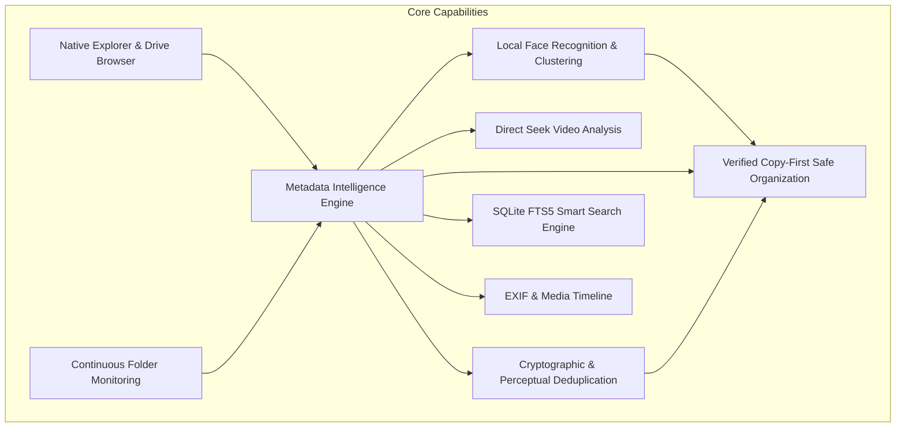

# Nexora — Feature Matrix & Capability Catalog

> **"Your files. Your intelligence. Your control."**  
> **Product Version:** `0.5.0`  
> **Platform:** Windows 11 Desktop (64-bit)  
> **Execution Paradigm:** 100% Local-First AI with Zero Cloud Uploads  

---

## 1. Feature Architecture Overview

Nexora unifies high-performance native Windows 11 filesystem browsing with private on-device artificial intelligence. Every capability in Nexora is designed to run completely offline without remote server calls, telemetry, or cloud subscriptions.

---

## 2. Complete Feature Inventory

### 2.1 Native Windows Explorer (`FR-01`)
- **Full Partition Enumeration**: Real-time discovery of all logical Windows volumes (`C:`, `D:`, etc.) via `fs.statfsSync` with drive letters, volume labels, total storage, used storage, and free space.
- **Directory Traversal**: High-speed folder navigation with path breadcrumbs, parent folder navigation, and history back/forward buttons.
- **Display Modes**: Toggle between List View (with metadata columns: Name, Date Modified, Type, Size) and Grid View (with responsive thumbnails).
- **Multi-Parameter Sorting**: Ascending and descending sort by Name, Date Modified, File Size, and File Extension.
- **Windows Shell Integration**: Actions to open files with the default OS handler (`shell.openPath`) or reveal items in Windows File Explorer (`shell.showItemInFolder`).

### 2.2 On-Device Facial Recognition & Clustering (`FR-02`)
- **Local Neural Inference**: Powered by the decoupled Python subprocess (`ai-worker/src/main.py`) via JSON-RPC.
- **Resolution Normalization**: Standardized 1600px image normalization across all hardware profiles to preserve vector embedding stability without accuracy drift.
- **Face Detection**: Fast multi-face detection capturing normalized bounding boxes (`x`, `y`, `width`, `height`), detection confidence ($\ge 0.70$), and quality scores.
- **Vector Embeddings**: 128-dimensional biometric embeddings capturing facial geometry.
- **Pairwise Cosine Clustering**: Aggregates identical individuals into identity clusters using strict distance thresholds ($0.60$).
- **People Management View**:
  - Assign human names to face clusters.
  - Review workflow: `unreviewed` -> `reviewed` -> `confirmed`.
  - Hide or exclude low-quality faces.
  - Merge duplicate person clusters.

### 2.3 Direct Seek Video Analysis (`FR-03`)
- **Non-Sequential Keyframe Seeking**: Utilizes `cap.set(cv2.CAP_PROP_POS_FRAMES)` to seek directly to keyframe timestamps, cutting CPU and RAM utilization by >90% compared to sequential decoding.
- **Redundant Frame Suppression**: 64x64 thumbnail difference comparison between consecutive sampled frames; static camera scenes bypass redundant neural scans.
- **Keyframe Observation Storage**: Stores detected faces, timestamp offsets, and frame numbers in SQLite `video_observations`.

### 2.4 Metadata Intelligence Engine (`FR-04`)
- **Multi-Format Extraction Pipeline**:
  - **Images**: Local EXIF headers (capture date/time, camera make, camera model, lens model, orientation, ISO, focal length, aperture, exposure time, GPS latitude/longitude/altitude).
  - **Videos**: Resolution (width/height), duration, frame rate, FourCC video codec, container format.
  - **Documents**: Safe PDF parser (%PDF- header validation, encryption detection, metadata dictionary title/author/subject, page count, and 3KB text preview); Office OpenXML (DOCX, PPTX, XLSX) read-only zip/xml parser reading Dublin Core title, creator, subject/description, page/word counts, and sample text without executing macros or embedded scripts.
  - **Audio**: WAV RIFF stream parameter extractor (sample rate, channels, byte rate, bitrate, duration); MP3 ID3v2 tag parser (TIT2 title, TPE1 artist, TALB album) and MPEG frame duration estimation; FLAC STREAMINFO metadata.
  - **Archives**: Safe ZIP and TAR entry inspection with password-encryption detection.
  - **Plaintext & Code**: Line counts, word counts, UTF-8/Latin-1 encoding detection, and text preview snippets.
- **Sandboxed Execution**: Traverses binary headers and structured XML trees only; macros, VBA scripts, and executable payloads are never executed.

### 2.5 Deduplication & Reclaimable Space Engine (`FR-05`)
- **Exact Cryptographic Deduplication**: Byte-for-byte SHA-256 content verification across 64KB chunked streams. Files with different names but identical contents are grouped into `exact` duplicate clusters.
- **Perceptual Similarity Deduplication**: 8x8 difference hashing (`dHash`) with Hamming distance $\le 2$ identifying visually identical photos or burst shots.
- **Duplicate Review & Resolution**:
  - Side-by-side candidate comparison with visual diffs.
  - Total reclaimable disk space calculation.
  - Non-destructive resolution actions: Keep Best Quality, Keep Newest, Move to Trash, or NTFS Hardlink replacement.
  - Duplicate groups are registered as `pending` and are **never** automatically deleted or overwritten without user confirmation.

### 2.6 Instant Smart Search (`FR-06`)
- **SQLite FTS5 Full-Text Search**: Indexed search across filenames, relative paths, metadata tags, OCR text, and document text previews.
- **Multi-Parameter Structured Filtering**:
  - File extension (e.g., `jpg, png, mp4, pdf, docx`).
  - Date ranges (From Date to To Date).
  - File size range (Minimum to Maximum MB).
  - Recognized and confirmed person identity filter.
  - Camera make and model filter.
  - Author and artist metadata filter.
- **Query Performance Timing**: Search queries measure and report execution duration in milliseconds (`executionTimeMs`).

### 2.7 EXIF Media Timeline (`FR-07`)
- **Chronological Grouping**: Groups media into chronological Year, Month, and Day views derived directly from EXIF `DateTimeOriginal`.
- **Date Fallbacks**: Uses `file_created_at` or `file_modified_at` when camera capture timestamps are missing.

### 2.8 Continuous Folder Watcher (`FR-08`)
- **Real-Time Monitoring**: Uses `chokidar` v4 to detect file additions, modifications, renames, and deletions in registered `watch_roots`.
- **Sliding Debounce Window**: 2000ms sliding buffer prevents system thrashing during large multi-gigabyte file copies.
- **Incremental Resynchronization**: Compares file `mtime` and size to skip unchanged files and re-index only altered records.

### 2.9 Verified Copy-First Safe Organization (`FR-09`)
- **Copy-First Invariant**: Original source files are immutable and never moved, renamed, or deleted automatically.
- **Template Pattern Engine**: Proposes target folder structures using template tokens:
  `{category}/{YYYY}/{MM}/{DD}/{person}/{camera}/{location}/{event}/{author}/{basename}`
- **Deterministic Safe Fallbacks**: Unresolved or ambiguous tokens resolve safely to `Unknown Date`, `Unassigned`, `Unknown Location`, `General`, `Unknown Camera`, or `Unknown Author`.
- **Atomic Copy Staging**: Copies files to temporary staging files (`.nexora-tmp-*`), verifies pre/post SHA-256 matching, and performs atomic rename to destination.
- **One-Click Rollback Guard**: All batch file operations maintain an audit log in `operation_history`. If a managed file was edited externally after copying, rollback protects and preserves the file.

### 2.10 Adaptive Hardware Management & Live Telemetry (`FR-10`)
- **Unprivileged Telemetry**: Real-time sampling of CPU cores, CPU load %, total/free RAM, memory pressure %, GPU name/VRAM/provider (`DirectML`/`CUDA`/`CPU`), and storage media (`SSD`/`HDD`) using unprivileged Windows APIs.
- **Four Operational Profiles**:
  - `low`: 1 worker, batch size 25, 1600px face detection, 5s video keyframe sampling, deferred heavy AI.
  - `balanced`: 2 workers, batch size 50, 1600px face detection, 5s video keyframe sampling.
  - `performance`: 4 workers, batch size 100, 1600px face detection, 3s video keyframe sampling.
  - `auto`: Automatically selects baseline from physical resources and dynamically throttles under resource pressure.
- **Hysteresis Anti-Oscillation Window**: 5-second minimum hold interval preventing rapid flapping between profiles.
- **Resumable Priority 4 AI Pipeline**: Under load, heavy AI tasks are deferred to persistent SQLite jobs, marking files with `processing_status = 'pending'`, and processing them when idle.
- **Queue Controls & Visibility**: Settings UI card with active, queued, pending AI, paused, failed, and completed job counters, items/sec throughput, and master Pause/Resume All controls.
